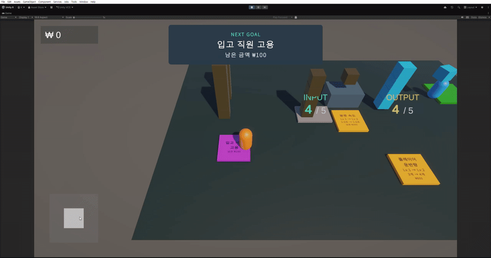
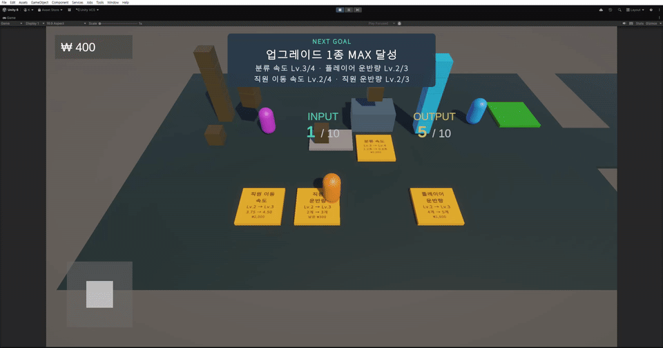
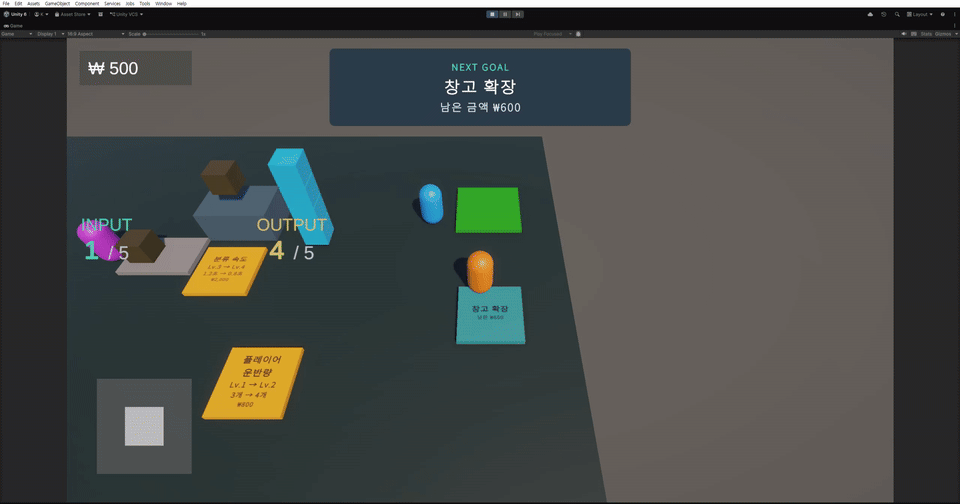

# Parcel Tycoon

직접 상자를 운반하던 작은 물류센터가 직원 고용과 시설 업그레이드를 통해 자동화되는 과정을 구현한 3D 타이쿤 게임입니다. SK AIGEN 지원 포트폴리오에서 구현 내용과 개발 과정을 소개하기 위한 저장소입니다.

플레이어는 입고된 상자를 분류대에 옮기고, 분류된 상자를 출고해 수익을 얻습니다. 수익으로 입고 시설과 직원을 해금하고, 운반량·이동 속도·분류 속도를 강화하며 창고를 확장합니다.

## 개발 환경

| 항목 | 환경 |
| --- | --- |
| 엔진 | Unity 6.3 LTS — **6000.3.10f1** |
| 언어 | C# |
| 렌더링 | Universal Render Pipeline 17.3.0 |
| 입력 / UI | Input System 1.18.0, uGUI 2.0.0 / TextMesh Pro |
| 목표 플랫폼 | Android, 가로 화면 / 16:9 |
| 개발·검토 환경 | Windows Unity Editor, PC 키보드 및 가상 조이스틱 |

의존성은 [manifest.json](Packages/manifest.json), [packages-lock.json](Packages/packages-lock.json)에 기록되어 있습니다. Android 실기기 성능과 배포 빌드 검증은 향후 개선 항목입니다.

## 플레이 영상

MainScene의 실제 플레이 GIF 3개입니다. 물류 자동화, 직원 다중 운반, 창고 확장을 순서대로 소개합니다. 원본 파일은 `Docs/Media`에 있으며 파일별 안내는 [GIF 안내](Docs/Media/README.md)에서 확인할 수 있습니다.

### 1. 물류 자동화

소개 기능: 입고 직원의 상자 전달 → 분류대의 자동 처리 → 출고 직원의 운반과 수익 획득으로 이어지는 물류 자동화입니다. 직접 운반하던 작업을 직원 고용으로 자동화하는 성장 흐름을 보여주는 영역입니다.

### 2. 직원 다중 운반

소개 기능: 입고·출고 직원이 여러 상자를 모아 한 번에 운반하는 동작입니다. 창고 확장 후 해금되는 공통 직원 운반량 업그레이드는 두 직원 모두에 적용되며, 운반량은 1 → 2 → 3개로 증가합니다. 추가 상자는 0.3초 획득 간격을 두고 수집합니다.

### 3. 창고 확장

소개 기능: 선행 시설·직원 구매와 업그레이드 누적 2회 조건을 충족한 뒤 창고를 확장하는 과정입니다. 확장 시 추가 구역이 활성화되고, Input/Output 용량이 각각 5 → 10으로 증가하며 직원 운반량 업그레이드를 해금합니다.

## 주요 구현 기능

| 시스템 | 구현 내용 | 주요 코드 |
| --- | --- | --- |
| 플레이어 | 키보드·가상 조이스틱 이동, 자동 상자 획득, 다중 운반, 카메라 추적 | [Player](Assets/_Project/Scripts/Player), [VirtualJoystick](Assets/_Project/Scripts/UI/VirtualJoystick.cs) |
| 물류 처리 | 상자 생성, Input 적재, 시간 기반 분류, Output 적재, 출고 수익 | [Parcel](Assets/_Project/Scripts/Parcel), [Sorting](Assets/_Project/Scripts/Sorting), [Delivery](Assets/_Project/Scripts/Delivery) |
| 직원 AI | 입고·출고 역할 분리, 탐색·획득·운반 상태 전환, 다중 운반과 획득 간격 | [Worker](Assets/_Project/Scripts/Worker) |
| 구매·업그레이드 | 시설·직원 구매, 부분 결제, 플레이어 운반량·직원 이동 속도·직원 운반량·분류 속도 강화 | [Purchase](Assets/_Project/Scripts/Purchase) |
| 진행 구조 | 단계별 해금, 업그레이드 누적 구매 조건, 창고 확장, 단계별 성장 목표 | [ProgressionManager](Assets/_Project/Scripts/Core/ProgressionManager.cs) |
| 창고 확장 | 추가 구역 활성화, Input/Output 용량 5 → 10, 직원 운반량 업그레이드 해금 | [WarehouseExpansionEffect](Assets/_Project/Scripts/Core/WarehouseExpansionEffect.cs) |
| 게임 UI | 한국어 Goal과 진행도, 가격·남은 결제액·MAX 표시, 실시간 Input/Output 수량 | [UI](Assets/_Project/Scripts/UI) |
| 저장·복원 | Save v3, v1/v2 마이그레이션, 자동 저장, 구매·업그레이드 완료 시 즉시 저장, 임시 파일과 백업 복구 | [SaveManager](Assets/_Project/Scripts/Core/SaveManager.cs), [SaveFileService](Assets/_Project/Scripts/Core/SaveFileService.cs) |
| 개발 도구 | Editor 저장 초기화, 진행·경제·패드 텍스트·적재·직원 운반 검증 코드 | [Editor 도구](Assets/_Project/Scripts/Editor), [검증 코드](Assets/_Project/Tests/Editor) |

## 게임 플레이 방법

1. **WASD / 방향키** 또는 화면 왼쪽 아래 **가상 조이스틱**으로 이동합니다.
2. 입고 구역의 미분류 상자에 접근해 획득하고, Input Plate에 운반합니다.
3. 분류가 끝난 상자를 출고 구역으로 옮겨 수익을 얻습니다.
4. 구매 패드에 머무르면 보유 재화로 부분 결제가 진행됩니다. 금액이 부족하면 나중에 이어서 결제할 수 있습니다.
5. 화면 상단 Goal을 따라 시설·직원을 해금하고 능력과 창고를 확장합니다.

신규 게임 시작 재화는 **₩0**입니다. 두 번째 입고 시설 **₩300** → 출고 직원 **₩500** → 입고 직원 **₩1,000** 순서로 초기 자동화를 진행합니다. 기본 입고 시설은 처음부터 사용할 수 있습니다.

이후 업그레이드를 누적 2회 이상 구매하면, 앞선 시설·직원 구매 조건과 함께 **창고 확장 ₩2,500**을 해금할 수 있습니다. 플레이어 운반량 업그레이드 가격은 **₩800 / ₩1,600**이며 구매 패드 결제는 **100원 / 0.2초** 단위입니다.

## 프로젝트 실행 방법

1. 저장소를 복제하거나 내려받습니다. Unity Hub에서 `Assets`, `Packages`, `ProjectSettings`가 있는 루트 폴더를 추가합니다.
2. **Unity 6000.3.10f1**로 열고 패키지 복원 및 최초 임포트가 끝날 때까지 기다립니다. 최초 복원에는 인터넷 연결이 필요합니다.
3. `Assets/_Project/Scenes/MainScene.unity`를 엽니다. `SampleScene`이나 테스트 씬이 아닌 MainScene에서 게임을 실행합니다.
4. Game View를 **16:9**로 설정하고 Play합니다.

Android 빌드에는 Unity Hub의 **Android Build Support, Android SDK & NDK Tools, OpenJDK** 모듈이 필요합니다. 현재 Android 설정은 IL2CPP·ARM64이며 MainScene이 빌드 씬으로 등록되어 있습니다. 빌드와 기기별 동작은 별도 확인이 필요합니다.

### 저장과 신규 게임 테스트

게임은 `Application.persistentDataPath/parceltycoon-save.json`에 진행 상황을 저장합니다. 같은 컴퓨터에서 이전 저장이 있으면 이어서 시작할 수 있습니다.

신규 게임 테스트는 **Play 종료 → Tools → ParcelTycoon → Reset Save Data → 확인창에서 초기화** 순서로 진행합니다. 현재 저장과 `.bak`, `.tmp`를 삭제하고 v1 역사 백업은 보존합니다. 이 작업은 되돌릴 수 없습니다.

### 검증 도구

Editor 메뉴의 `Progression Balance Checks`, `Validate Purchase Pad Layout`, `Validate Sorting Status UI`, `Validate Save Reset (Temporary Files Only)` 및 별도 테스트 씬·검증 코드가 포함되어 있습니다. 각 도구의 실행 조건과 씬을 확인한 뒤 사용합니다. 일부 검증은 씬을 열거나 테스트 상태를 구성하므로 작업 중인 씬을 먼저 저장해 주세요.

이번 공개 준비 작업에서는 게임 실행·Android 빌드·전체 테스트를 새로 수행하지 않았습니다.

### 공개 전 최소 실행 체크리스트

아래 항목은 **수동 확인용이며 아직 이번 작업에서 실행하지 않았습니다.** 신규 게임·저장 복원 검사는 촬영용 진행 기록을 덮어쓰지 않는 테스트용 저장 환경에서 진행합니다.

- [ ] **실행:** Unity 6000.3.10f1에서 패키지 복원·컴파일 후 MainScene을 16:9로 실행하고, Console에 컴파일 오류·Missing Reference·반복 예외가 없는지 확인합니다.
- [ ] **신규 게임:** 재화 ₩0, Goal `두 번째 입고 시설 해금`, 구매 가능한 추가 입고 ₩300과 나머지 초기 잠금 상태를 확인합니다.
- [ ] **기본 물류:** WASD·방향키·가상 조이스틱으로 이동하고, 상자 획득 → Input 전달 → 분류 → 출고가 이어져 상자당 ₩100 수익을 얻는지 확인합니다.
- [ ] **구매·해금:** 추가 입고 → 출고 직원 → 입고 직원 순서, Carry / Sorting Speed / Worker Speed의 단계별 해금, 100원·0.2초 부분 결제와 패드 이탈 후 결제 중단·잔액 보존을 확인합니다. 신규 플레이에서 Carry 가격은 ₩800 / ₩1,600인지 확인합니다.
- [ ] **직원·확장:** 창고 확장은 선행 구매와 업그레이드 2회 조건을 충족해야 열리는지 확인합니다. 확장 전후 Input/Output 용량 5 → 10, Input의 두 열 5+5 적재, 확장 후 직원 운반량 1 → 2 → 3개가 두 직원에 적용되는지 확인합니다. 수집 간격·분류 전달·출고가 멈추지 않아야 합니다.
- [ ] **화면·목표:** 한국어 Goal, `업그레이드 2회 구매`의 0/2·1/2와 달성 후 전환, 가격·부분 결제·MAX, Input/Output 수량이 잘리거나 겹치지 않는지 확인합니다. 플레이어 이동에 따른 카메라 추적 중에도 시설과 패드가 구분되는지 확인합니다.
- [ ] **저장·재실행:** 부분 결제 중과 구매·업그레이드·확장 완료 후 각각 종료·재실행하여 재화·결제액·레벨·구매 상태·Goal·직원 운반량이 복원되는지 확인합니다. 기존 저장의 ₩50 단위 잔액은 마이그레이션으로 보존될 수 있으므로 신규 게임 경제 검사와 구분합니다.
- [ ] **포트폴리오 표시:** 지정 경로의 GIF 3개가 GitHub README에서 재생되고, 한글 파일명 경로·캡션과 실제 영상 내용이 일치하는지 확인합니다. 로컬 파일 존재·형식·미리보기와 이미지 삽입 구문은 점검했으며, GitHub상의 실제 표시는 별도 확인 대상입니다.

Android 실행을 포트폴리오에서 검증 완료로 소개하려면, 위 항목 외에 실제 기기에서 설치·실행·터치 입력·저장 복원을 별도로 확인해야 합니다. v1/v2 → v3 마이그레이션과 `.bak` 복구는 기존 격리 검증 코드로 추가 확인하며, 실제 촬영용 저장 파일을 손상시켜 시험하지 않습니다.

## 개발 과정에서 해결한 주요 문제

- **구매 패드의 한국어 텍스트 잘림·경계 이탈:** Noto Sans KR SDF와 전용 재질을 유지하면서 패드 표면 안에 표시 영역을 제한했습니다. 일반 구매·부분 결제·MAX 문구의 TMP 메시 경계를 검사하는 Editor 검증을 추가했습니다.
- **Input 적재 기준점 불일치:** 기존 InputPoint에 보정값을 누적하는 방식에서 벗어나, Plate 기준의 명시적인 `InputStackAnchorA/B`로 1~5개와 6~10개의 두 열을 구성했습니다.
- **쿼터뷰의 시설 패드 배치:** 정적 씬 좌표뿐 아니라 플레이어 추적 카메라의 실제 화면 구도와 비교 렌더를 기준으로 분류 속도 패드 배치를 조정했습니다.
- **직원의 연속 획득과 다중 운반:** 입고·출고 직원에 공통 운반량 업그레이드를 적용하고, 상자 획득 간격과 수집 시간 제한으로 운반 상태 전환을 정리했습니다.
- **진행·경제·저장 간 일관성:** 코드 기본값과 MainScene 직렬화 값을 함께 맞추고, 누적 업그레이드 조건·100원 단위 결제·기존 저장 마이그레이션을 검증하는 코드를 마련했습니다.
- **한국어 Goal의 영문 fallback:** 기존 글리프를 확인해 한국어를 표시하고, 지원되지 않는 경우 영문 fallback을 유지하도록 구성했습니다.

## 현재 상태와 향후 개선

현재는 직접 운반부터 직원 자동화, 업그레이드, 창고 확장, 목표 진행 및 저장 복원까지 이어지는 **플레이 가능한 프로토타입**입니다. 완성된 상용 게임이나 성능 검증을 마친 Android 배포판을 의미하지는 않습니다.

향후에는 Android 실기기 성능·입력·해상도 대응, 경제 밸런스와 신규 플레이 경험, 직원 탐색 비용, 튜토리얼·사운드·피드백을 개선할 예정입니다. 컨베이어 등 추가 자동화 콘텐츠는 향후 검토 대상으로 구분합니다.

주차별 초기 개발 기록은 [Docs/Weekly](Docs/Weekly)에 보관되어 있습니다.

## 외부 리소스 및 공개 준비 상태

폰트와 Unity/TMP 리소스의 고지, EmojiOne 확인 상태는 [THIRD_PARTY_NOTICES.md](THIRD_PARTY_NOTICES.md)에 정리했습니다. 각 외부 리소스에는 해당 라이선스가 별도로 적용됩니다. 이 저장소 전체에 일괄적인 오픈소스 라이선스를 부여한 것은 아닙니다.

**현재 TMP에 포함된 EmojiOne 이미지의 정확한 원본 버전·재배포 조건은 추가 확인이 필요합니다. Public 전환 전 이 항목을 해결해야 합니다.** 사용 흔적이 없다는 이유만으로 파일을 제거하거나 공개 가능하다고 판단하지 않았습니다.

정리 대상과 공개 전 확인 사항은 [공개 준비 기록](Docs/PublicationReadiness.md)에 기록했습니다.
